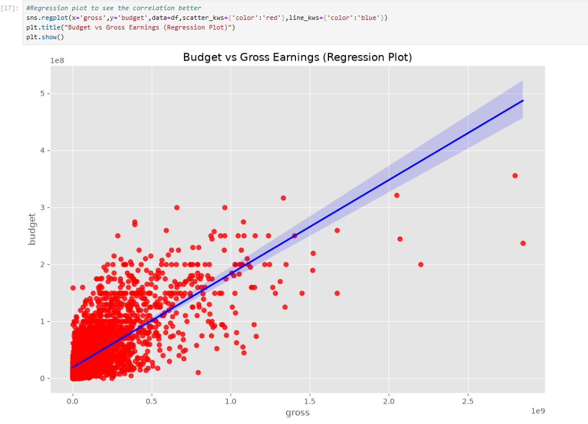
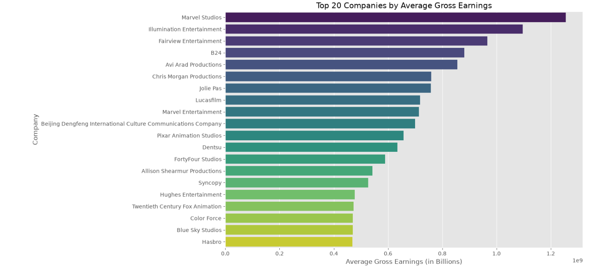

# Movie Industry Data Analysis

## Project Overview
This project is an exploratory data analysis (EDA) of the movie industry, focusing on data cleaning, handling missing values, and finding correlations between various movie attributes. The main goal was to determine the relationship between a movie's production budget and its gross revenue.

## Tools & Libraries Used
*   **Python** (Pandas, NumPy)
*   **Data Visualization** (Matplotlib, Seaborn)
*   **Environment** (Jupyter Notebook)

## Data Cleaning Process
1.  **Missing Values:** Checked for missing data. Dropped rows with missing values in critical columns (`budget` and `gross`) to ensure the accuracy of the correlation analysis.
2.  **Formatting:** Converted data types (e.g., removing '0's from budget/gross and changing them to integer types).
3.  **Consistency Check:** Compared the `year` and `released` columns. Found 713 mismatches, which were determined to be due to original release dates vs. US release dates.
4.  **Duplicates:** Verified there were no duplicate rows in the dataset.

## Visualizations & Key Findings

### 1. Budget vs. Gross Earnings (Regression Plot)
As seen in the plot below, there is a **strong positive correlation** between the budget and gross earnings. Higher budget generally leads to higher revenue.

### 2. Top Companies by Average Gross Earnings
To analyze categorical data (company) properly, I used `groupby` instead of numerical correlation. The bar chart shows that major studios like **Marvel Studios** and **Illumination Entertainment** have significantly higher average gross earnings.

## Conclusion
The analysis confirms a strong positive relationship between a movie's budget and its box office success. Furthermore, while categorical data (like company names) cannot be accurately correlated mathematically, grouped analysis shows that major production studios dominate the average box office revenue.

## How to Run
1. Clone the repository.
2. Ensure you have Pandas, Seaborn, and Matplotlib installed.
3. Open the `Movie_Data_Cleaning_and_EDA.ipynb` file in Jupyter Notebook.
